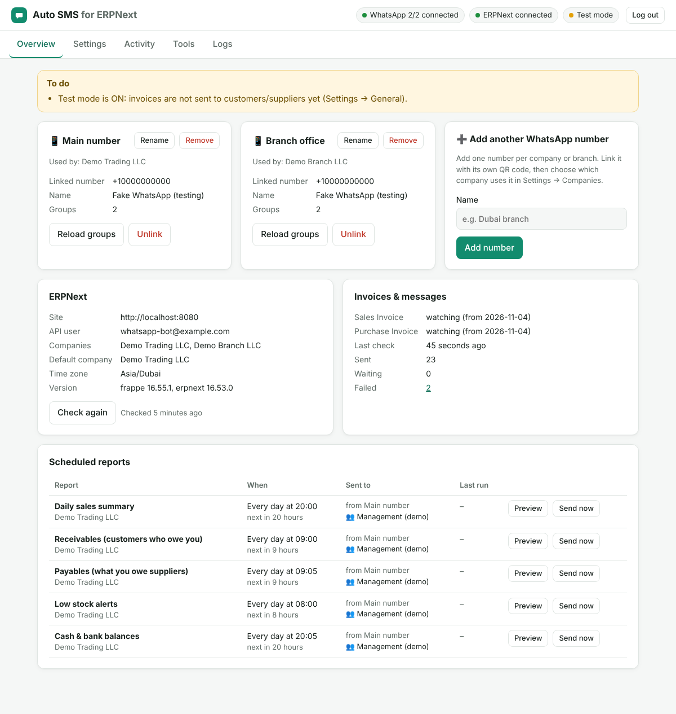
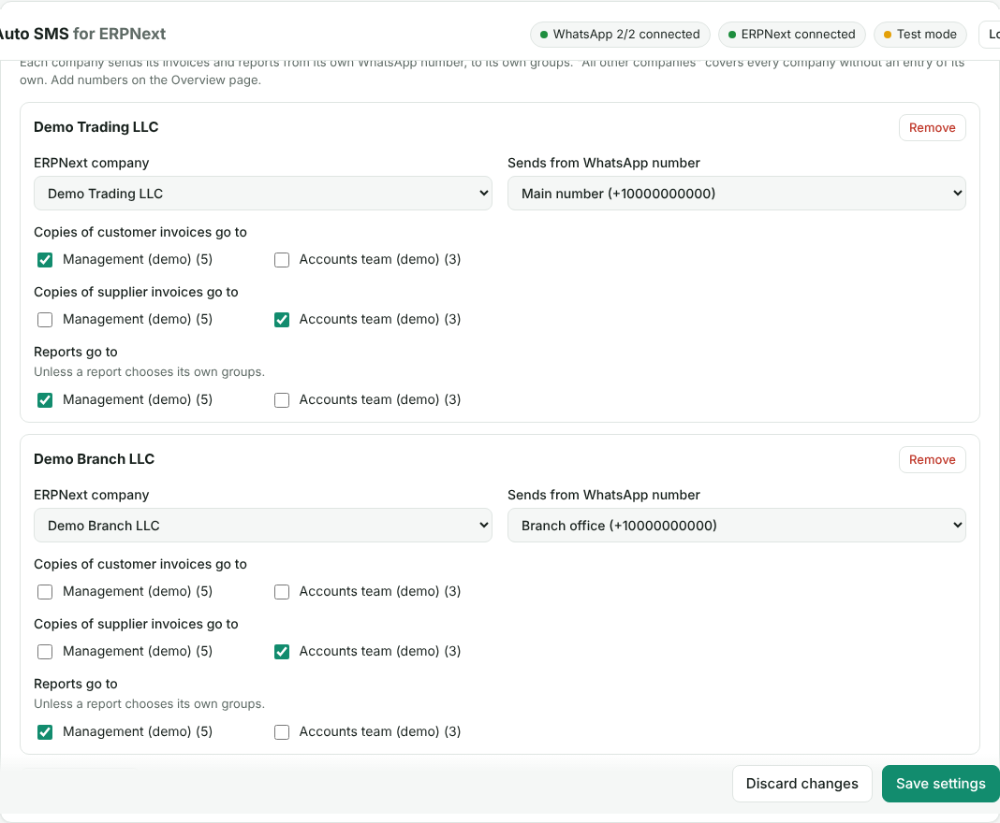

# Auto SMS for ERPNext

A small standalone service that connects **ERPNext** to **WhatsApp**. It runs next to ERPNext, not inside it:

- 🧾 **Customer invoices**: when a Sales Invoice is submitted, its PDF goes to the customer's WhatsApp with a personal message.
- 📥 **Supplier invoices**: when a Purchase Invoice is submitted, a confirmation with the PDF goes to the supplier, and a copy goes to your internal group (for example Accounts).
- 📊 **Reports to WhatsApp groups** on a schedule: daily sales summary, receivables, payables, low-stock alerts, cash & bank balances, and **any ERPNext report** you name.
- 📱 **Several WhatsApp numbers**: link as many numbers as you like. Each ERPNext company sends from its own number, to its own groups.
- 🖥️ **Dashboard**: link WhatsApp by QR code, choose groups, edit messages and schedules, see every message and retry failures.
- 🧪 **Test mode** (on by default): customer and supplier messages go to *your* test number until you are happy with them.



---

## How it works

```
 ERPNext  ── REST API (read-only user) ──▶  Auto SMS for ERPNext  ── linked device ──▶  WhatsApp
   │                                         │  • checks for new invoices every minute
   └── optional Webhook (instant) ─────────▶ │  • runs reports on schedule
                                             │  • queue with pacing & retries (SQLite)
                                             └─ dashboard on http://your-server:3000
```

- It only **reads** from ERPNext, using an API key. Nothing is installed in ERPNext. A webhook is optional.
- WhatsApp is linked like **WhatsApp Web** (Linked devices → QR code), so the service can post into your existing groups.
- Invoices are never sent twice. Invoices that already existed when you installed the service are not sent automatically.

> ⚠️ **About the WhatsApp link.** This uses the WhatsApp Web protocol (the open-source [Baileys](https://github.com/WhiskeySockets/Baileys) library), not Meta's paid Business API. That is what lets it post into normal WhatsApp groups. It is not an official integration, so use a **dedicated business number** (WhatsApp or WhatsApp Business app), only message people who expect your messages, and keep the default pause between messages. Numbers that spam can be banned by WhatsApp.

---

## Setup (about 15 minutes)

### 1. Create an API user in ERPNext

1. In ERPNext go to **User → Add User**, for example `whatsapp-bot@yourcompany.com`, type *System User*.
2. Give it these roles: **Accounts User, Sales User, Purchase User, Stock User**. It only needs to read.
3. Open the user → **Settings → API Access → Generate Keys**. Copy the **API Key** and **API Secret**.

### 2. Install it on your server

It must run on a server that is **always on** and can reach your ERPNext and the internet, for example the same Hostinger VPS where ERPNext runs. (A static host like GitHub Pages can't run it: it keeps a live WhatsApp connection and checks ERPNext all day.) You then open the dashboard from any phone or computer.

Open a terminal on the server. On Hostinger: **hPanel → VPS → your server → Browser terminal** (works on a phone too), or SSH. Then:

**a) Download the code.** The repository is private, so log in to GitHub once:

```bash
apt-get update && apt-get install -y git gh
```

```bash
gh auth login
```

Choose *GitHub.com → HTTPS → Login with a web browser*. It shows a code: open **github.com/login/device** on your phone, enter the code and approve. Then:

```bash
gh repo clone aliiherzi/auto-sms-for-erpnext /opt/auto-sms
```

**b) Install and start:**

```bash
sudo bash /opt/auto-sms/install.sh
```

It installs Docker if needed, creates `/opt/auto-sms/.env` with a strong dashboard password, picks a free port (3000, or the next free one), starts the service and prints:

```
==> Auto SMS for ERPNext is running.
   Dashboard: http://203.0.113.10:3000
   Password:  …
```

Open that address on your phone or computer and log in. If it doesn't open, allow the port in the server's firewall (Hostinger: *hPanel → VPS → Security → Firewall*, add TCP 3000; or `ufw allow 3000/tcp`).

**Update later** (keeps your settings, WhatsApp links and history):

```bash
cd /opt/auto-sms && git pull && sudo bash install.sh
```

> The printed address uses plain `http`. For daily use give it a name with HTTPS, see [Your own web address](#your-own-web-address-https) below.

<details>
<summary>Manual install with Docker (any server)</summary>

```bash
git clone https://github.com/aliiherzi/auto-sms-for-erpnext.git
```

```bash
cd auto-sms-for-erpnext
```

```bash
cp .env.example .env
```

Edit `.env` and set `ADMIN_PASSWORD`, then:

```bash
docker compose up -d --build
```

Open **http://your-server:3000**.

</details>

### 3. Connect ERPNext

**Settings → ERPNext connection**: enter the address (for example `https://erp.yourcompany.com`), API key and secret, then **Test connection** and **Save settings**. Also set your **Default country code** (for example `971`, `966`, `254`) under **General**, so local numbers like `050…` work.

### 4. Link WhatsApp

On **Overview**, the *Main number* card shows a QR code. On the phone that owns the number: **WhatsApp → Settings (or ⋮) → Linked devices → Link a device**, then scan it.
If you are using the phone you want to link, open **"Can't scan? Link with phone number instead"** to get an 8-character code to type in WhatsApp.

**More numbers:** use **Add another WhatsApp number** (for example "Dubai branch"), then link it the same way.

### 5. Choose companies, numbers and groups

**Settings → Companies & WhatsApp numbers**. For each ERPNext company choose:

- which **WhatsApp number** sends its messages
- which **groups** get copies of customer invoices and of supplier invoices
- which **groups** receive its reports

"All other companies" covers every company that has no entry of its own. With one company and one number, just fill in that single entry.



### 6. Test, then go live

**Test mode** is on at first. Set **Settings → General → Test recipient** to your own number, submit a test invoice in ERPNext, and check the message on your phone (also listed under **Activity**). Use **Tools → Send a test message** to check groups. When everything looks right, untick **Test mode** and save.

---

## What gets sent

### Customer invoices (Sales Invoice)

When an invoice is **submitted**, the service finds the customer's number in this order:

1. the custom WhatsApp field on the Customer, if you set one (*Settings → Invoice options*)
2. the **contact mobile** picked on the invoice
3. the Customer's **Mobile No** (from its primary contact)
4. any **Contact** linked to the customer (primary first, mobile before phone)

The ERPNext PDF (your print format and letter head) is sent with this message. You can edit it in Settings:

```
Dear Acme Trading,

Please find attached your invoice *ACC-SINV-2026-00010* dated 04-11-2026.

Amount: *AED 777.00*
Due date: 14-11-2026

Thank you for your business.
*Demo Trading LLC*
```

The groups you chose get a short copy showing whether the customer received it:

```
🧾 *New Sales Invoice* ACC-SINV-2026-00010
Customer: Acme Trading
Amount: *AED 777.00*
Due: 14-11-2026
Sent to the customer on +971501234567
```

If a customer has no usable number, the message is listed as **failed** under Activity with the reason. Fix the contact in ERPNext, then press **Retry**.

### Supplier invoices (Purchase Invoice)

The supplier gets a confirmation with the PDF, and your internal group gets a copy:

```
Dear Delta Supplies,

We confirm that we have received and recorded your invoice *DS-36910*.

Our reference: ACC-PINV-2026-00004
Invoice date: 03-11-2026
Amount: *AED 420.00*
Payment due: 04-12-2026

*Demo Trading LLC*
```

### Rules that keep it safe

- Only **submitted** invoices are sent. Drafts and cancelled invoices are not.
- Each invoice is sent **once**. Payments or edits later do not send it again.
- Invoices that existed before you installed the service, and invoices dated more than *N* days back (default 3), are not sent automatically. You can still send any invoice from **Tools → Send an invoice now**.
- Credit notes and debit notes are sent too (you can turn this off).
- Messages wait if WhatsApp is disconnected and are sent when it reconnects. After 3 days they expire instead of surprising customers.
- Temporary errors are retried (30 s, 2 min, 10 min, 30 min). Permanent ones, such as a number with no WhatsApp, are not.

### Message variables

`{{name}}` `{{doc_title}}` `{{doc_label}}` `{{party_name}}` `{{company}}` `{{posting_date}}` `{{due_date}}` `{{grand_total}}` `{{outstanding_amount}}` `{{paid_amount}}` `{{currency}}` `{{bill_no}}` `{{bill_date}}` `{{po_no}}` `{{party_delivery}}`, plus any invoice field as `{{doc.fieldname}}`.

Optional parts: `{{#due_date}}Due: {{due_date}}{{/due_date}}` only appears when there is a due date. WhatsApp formatting works: `*bold*`, `_italic_`.

---

## Reports

All schedules can be changed in **Settings → Reports**: every day, Monday–Friday, weekly, monthly, or a custom cron expression. Times are in the ERPNext time zone unless you set one. Each report goes to the groups of its company, or to groups you pick for that report. **Preview** shows the message without sending it.

| Report | Default time | Contents |
|---|---|---|
| Daily sales summary | every day 20:00 | invoices, total, returns, paid vs unpaid, payments received, month to date, top customers |
| Receivables | every day 09:00 | total owed to you, overdue amount, customers with the most overdue |
| Payables | every day 09:05 | total you owe, overdue amount, suppliers |
| Low stock alerts | every day 08:00 | items at or below their re-order level (Item → Auto re-order). Sent only when something is low |
| Cash & bank balances | every day 20:05 | balance of every Bank and Cash account |
| Any ERPNext report | your choice | any report by name (for example *Gross Profit*, *Accounts Receivable Summary*) with filters, as text or as a CSV file |

Real output from the test run:

```
📊 *Daily Sales Summary*
*Demo Trading LLC* · Wed, 04-11-2026

🧾 Invoices: *11* · *AED 4,507.00*
✅ Paid: AED 2,554.00
⏳ Unpaid: AED 1,953.00
💰 Payments received: *AED 2,554.00* (3)
📅 Month to date (Nov 2026): *AED 4,907.00*

*Top customers*
1. Acme Trading – AED 3,069.00
2. Beta Stores – AED 1,000.00
3. Gamma Foods – AED 438.00
```

```
💰 *Receivables* – money customers owe you
*Demo Trading LLC* · Wed, 04-11-2026

Total outstanding: *AED 5,353.00* (11 invoices)
Overdue: *AED 3,000.00* (1 invoice)

*Top 3 customers*
1. *Gamma Foods* – AED 3,438.00
    overdue AED 3,000.00 · oldest 30 days
2. *Beta Stores* – AED 1,400.00
    not due yet
```

```
📦 *Low Stock Alert*
*Demo Trading LLC* · Wed, 04-11-2026

*1* item at or below re-order level:

🟠 *Widget A*
    Stores - DT: 10 Nos · re-order at 20, order 50
```

```
🏦 *Cash & Bank Balances*
*Demo Trading LLC* · Wed, 04-11-2026

🏦 Emirates NBD: *AED 50,000.00*
💵 Cash: *AED 5,054.00*

*Total:* AED 55,054.00
```

For an ERPNext report, filters are JSON and can use `{{today}}`, `{{yesterday}}`, `{{week_start}}`, `{{month_start}}`, `{{year_start}}` and `{{company}}`, for example:

```json
{ "company": "{{company}}", "from_date": "{{month_start}}", "to_date": "{{today}}" }
```

---

## Optional: instant sending with an ERPNext Webhook

Without a webhook, new invoices are picked up within a minute. For instant sending, set `WEBHOOK_SECRET` in `.env`, then in ERPNext create a **Webhook** (search "Webhook" → *Add Webhook*):

| Field | Value |
|---|---|
| Name | `WhatsApp – Sales Invoice` |
| DocType | `Sales Invoice` |
| Doc Event | `on_submit` |
| Request URL | `https://sms.yourcompany.com/webhooks/erpnext`, or `http://127.0.0.1:3000/webhooks/erpnext` when ERPNext runs on the same server without Docker |
| Request Method | `POST` |
| Request Structure | `JSON` |
| JSON Request Body | `{"doctype": "{{ doc.doctype }}", "name": "{{ doc.name }}"}` |
| Enable Security | ✔, with **Webhook Secret** = the same value as `WEBHOOK_SECRET` |

Create a second one for `Purchase Invoice`. Calls without the correct signature are rejected. Checking every minute stays on as a safety net, and nothing is sent twice.

---

## Your own web address (HTTPS)

Give the dashboard a name such as `https://sms.yourcompany.com`, so your password and messages travel encrypted and it opens like any website, on phone and computer.

1. **DNS.** Where your domain is managed (Hostinger: *hPanel → Domains → DNS / Nameservers*), add an **A record**: name `sms`, points to your server's IP address.
2. **Hide the plain-http port.** In `/opt/auto-sms/.env` set these two lines, then run `sudo bash /opt/auto-sms/install.sh` again:

   ```
   BIND_ADDRESS=127.0.0.1
   TRUST_PROXY=true
   ```

3. **Add HTTPS.** How depends on what already answers on ports 80/443 of the server. Use the port install.sh printed if it isn't 3000.

   **nginx** (the usual ERPNext "bench" production setup). Create `/etc/nginx/conf.d/auto-sms.conf`:

   ```nginx
   server {
       listen 80;
       server_name sms.yourcompany.com;
       location / {
           proxy_pass http://127.0.0.1:3000;
           proxy_set_header Host $host;
           proxy_set_header X-Forwarded-For $proxy_add_x_forwarded_for;
           proxy_set_header X-Forwarded-Proto $scheme;
       }
   }
   ```

   Then reload nginx and get the certificate:

   ```bash
   nginx -t && systemctl reload nginx
   ```

   ```bash
   apt-get install -y certbot python3-certbot-nginx && certbot --nginx -d sms.yourcompany.com
   ```

   **Nothing on 80/443 yet** (ERPNext runs on another server). [Install Caddy](https://caddyserver.com/docs/install#debian-ubuntu-raspbian), put this in `/etc/caddy/Caddyfile` and run `systemctl reload caddy`. It gets the certificate by itself:

   ```
   sms.yourcompany.com {
       reverse_proxy 127.0.0.1:3000
   }
   ```

   **Traefik** (ERPNext installed with frappe_docker). Add a router for `sms.yourcompany.com` to `http://<server-ip>:3000`, the same way your ERPNext site is set up.

## Running without Docker

Needs **Node.js 22.13 or newer**.

```bash
npm ci
```

```bash
npm run build
```

```bash
cp .env.example .env
```

```bash
npm start
```

Keep it running with your process manager (systemd, pm2…). All data lives in `./data` (or `DATA_DIR`).

## Updating and backups

```bash
cd /opt/auto-sms && git pull && sudo bash install.sh
```

Everything the service keeps is in the `auto-sms-data` Docker volume (`/data`): `settings.json`, the message database, and `whatsapp-auth/` (the linked sessions). Back up that volume. If you lose `whatsapp-auth`, you only need to scan the QR codes again.

## Security notes

- The ERPNext API user only needs read roles. Don't use an Administrator key.
- `settings.json` holds the ERPNext API secret, and `whatsapp-auth/` holds the WhatsApp sessions: anyone with these files can send messages as your numbers. Keep the volume private.
- Use a strong `ADMIN_PASSWORD`, and HTTPS when the dashboard is reachable from the internet. After 5 wrong passwords, logins from that address are blocked for 5 minutes.
- Removing a number in the dashboard unlinks it from WhatsApp. You can also remove it on the phone under *Linked devices*.

## Troubleshooting

| Problem | What to do |
|---|---|
| **PDF error "Connection error"** | ERPNext v16 renders PDFs with Chrome, which it downloads on first use. If your ERPNext server has no internet access, choose **wkhtmltopdf** in *Settings → Invoice options → PDF generator*. With wkhtmltopdf, v16's standard print format can be cut off on the right; a custom print format avoids that. Also check that *Print → PDF* works inside ERPNext. |
| **PDF error "ConnectionRefusedError"** (Docker ERPNext) | ERPNext's PDF tool can't reach its own site. Run `bench --site <site> set-config host_name http://<frontend-container>:8080` and restart ERPNext. |
| "ERPNext rejected the API key/secret" | Generate the keys again on the API user and update them in Settings. |
| "… has no mobile number in ERPNext" | Add a mobile number to the customer's or supplier's primary contact, then press **Retry** in Activity. |
| Local numbers fail | Set the **Default country code** in Settings → General. |
| "only admins can post" next to a group | That group is admin-only. Make the linked number a group admin. |
| WhatsApp keeps showing "not linked" | Link again from Overview. If it says *logged out*, the device was removed on the phone. A message such as "connection refused (HTTP 403)" means a firewall or proxy blocks `web.whatsapp.com`; set `WHATSAPP_PROXY` if your network needs a proxy. |
| A report says "No WhatsApp group selected" | Choose report groups for the company in *Settings → Companies & WhatsApp numbers*. |
| Low-stock report is empty | Set re-order levels on items (*Item → Inventory → Auto re-order*). |

**Logs** (dashboard → Logs, or `docker compose logs -f`) explain every decision in plain words.

---

## Development

```bash
npm ci
```

```bash
npm run dev           # runs src/main.ts with reload
```

```bash
npm run typecheck && npm test
```

Set `WHATSAPP_DRIVER=fake` to try the dashboard without a phone. Messages are then only recorded, never sent.

### End-to-end tests against a real ERPNext

`test/integration` creates demo data (two companies, customers with and without numbers, suppliers, items with re-order levels, invoices, payments) in a **test** ERPNext site. It then checks invoices, real PDFs, both companies' numbers, test mode, a signed ERPNext webhook and every report. WhatsApp is replaced by an in-memory stand-in.

The easiest test ERPNext is [frappe_docker](https://github.com/frappe/frappe_docker)'s `pwd.yml`. After the site is up and the setup wizard is done, create an API user with the roles above, and keys for Administrator, then:

```bash
ERPNEXT_TEST_URL=http://localhost:8080 \
ERPNEXT_TEST_KEY=... ERPNEXT_TEST_SECRET=... \
ERPNEXT_TEST_ADMIN_KEY=... ERPNEXT_TEST_ADMIN_SECRET=... \
npm run test:integration
```

⚠️ Never point the integration tests at a real company; they create documents.

### Project layout

```
src/
  main.ts                 start-up
  app.ts                  wires everything together
  config/                 .env and settings (validated with zod)
  erpnext/                REST client, contact lookup, company/time-zone context
  whatsapp/               Baileys connection, multi-number manager, fake driver
  messaging/outbox.ts     queue: pacing, retries, one sender per number
  invoices/               invoice → messages, and the watcher (polling)
  reports/                the report builders and the scheduler
  web/                    dashboard API, login, webhook, static dashboard (public/)
test/                     unit tests and the real-ERPNext end-to-end suite
```

### Licences of the main libraries

[Baileys](https://github.com/WhiskeySockets/Baileys) (MIT) depends on `libsignal` (GPL-3.0). Using this service inside your company is fine. If you ever *distribute* it to others, the GPL terms apply to that distribution.
